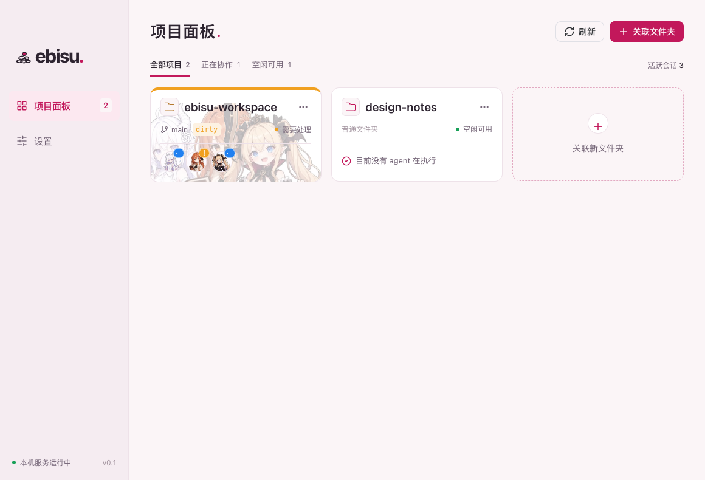
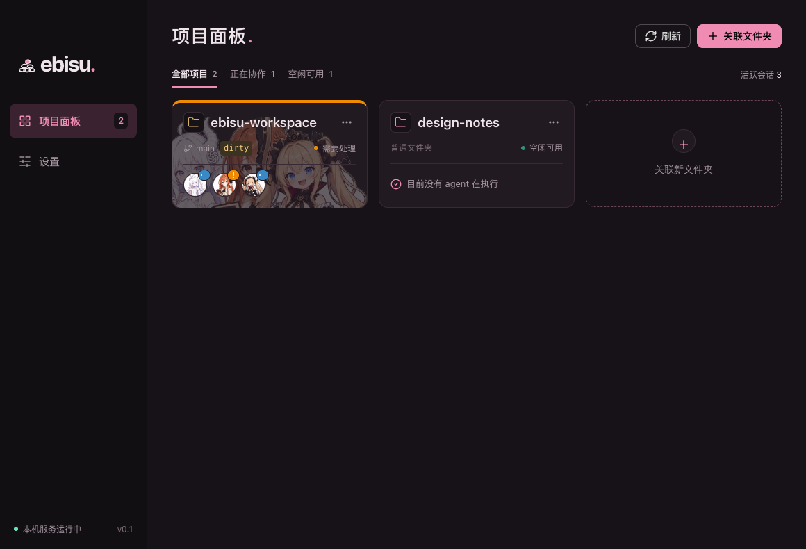

<p align="center">
  
</p>
<h1 align="center">Ebisu</h1>
<p align="center">本地项目与 Agent 会话状态面板</p>

把常驻的项目收进一个安静的面板：随时看到 Git 状态、哪些 agent 正在协作，以及哪些会话在等你处理。使用 Electron、TypeScript、Vue 3、Pinia、Naive UI 和 SQLite，首期面向 macOS Apple Silicon。

文档：[本机通知协议](docs/API.md) · [终端适配与验收边界](docs/INTEGRATIONS.md)

## 特性

- **项目总览**：Git 仓库与普通文件夹都能添加，不同 worktree 分别管理；长标题自动省略，悬停查看完整路径、分支与改动。
- **会话状态**：执行中、等待输入和空闲通过卡片边框与指示灯区分；头像、任务标题和完整会话 ID 就近查看。
- **终端接入**：内置 Codex、WorkBuddy、Claude Code、Grok、Qoder 的规则、skill 与原生 hook 集成，安装前备份，卸载只清除 Ebisu 管理的配置。
- **桌面驻留**：托盘弹窗复用同一项目面板，关闭主窗口仅隐藏；支持跟随系统、浅色和深色主题。
- **本地优先**：服务只监听 `127.0.0.1`，所有请求需要 bearer token，不保存提示词、回复或 Git diff，也不提供 agent 控制操作。

## 界面

| 浅色 | 深色 |
| --- | --- |
|  |  |

界面使用线性垒石标记，主色系取自绯红、玫粉与冰蓝的低饱和组合。

## 运行

需要 Node.js 22.12+ 和 pnpm 10。建议使用 Node.js 24 LTS。

```sh
pnpm install
pnpm dev
```

本地开发页面默认使用 `http://localhost:4175`，端口被占用时会报错。
`pnpm dev` 同时监听主进程和 preload：主进程代码变化后自动重启 Electron，preload 变化后重新加载页面，避免界面已更新而任务标题、通知服务等仍运行旧逻辑。
从未开启监听的旧开发进程切换时，需要先退出旧进程，再运行一次 `pnpm dev`。

生成的安装包位于 `dist/`。将 Ebisu 拖入“应用程序”后启动，避免安装的通知工具引用临时挂载路径。

```sh
pnpm package:mac
```

本地构建不包含 Apple Developer ID 签名和公证。正式分发时需自行配置签名身份与公证凭据。

## 使用

1. 点击“关联文件夹”，选择 Git 仓库或普通文件夹。普通文件夹不显示 Git 区域；不同 worktree 分别添加。
2. 在“设置”检查自动探测结果，按需安装各终端的通知集成。不会自动修改所有终端配置。
3. 重启已有 agent 会话，使全局规则与 hook 生效。终端开始处理已注册目录后，其会话会出现在卡片上。
4. 执行中显示蓝色上边框和圆点；任一会话等待输入时显示黄色及“需要处理”。恢复执行后清除等待标记，完成、失败或取消后释放。十分钟无新请求也会释放。
5. 点击托盘图标可查看同一项目面板。关闭主窗口仅隐藏窗口，彻底退出请使用托盘右键菜单或 Cmd+Q。

卡片上的 Git clean 颜色与目录忙碌灯独立：Git 干净的目录也可能正在被 agent 阅读或规划。增删改按文件统计，暂存与工作区重复改动只算一次；重命名和冲突算修改，未跟踪文件算新增。

头像详情中的“任务”显示终端提供的真实会话标题。Codex 可从本地会话索引读取与应用标题栏一致的名称，后续改名也会同步；其他终端通过通知协议上报。未取得标题时显示“未提供”，不会根据提示词生成或猜测。

项目标题与文件夹图标同行，长标题自动省略。悬停图标查看完整名称、路径、分支、Git 状态和增删改数量；通过三点菜单在 Finder 中打开目录。会话以单行头像显示，超出时收纳到“+x”；悬停头像或“+x”查看详情并复制完整会话 ID，面板不提供 agent 控制操作。头像来自已确认的模型名，模型未知时使用终端商标；设置页可替换本地头像。

## 接入机制

通知集成包含全局常驻规则、通知 skill 和原生生命周期 hook。skill 本身是模型按需调用的能力，不能提供强制执行保证，因此 hook 与规则共同补充。

| 终端 | 规则 | Skill | Hook 配置 |
| --- | --- | --- | --- |
| Codex | `~/.codex/AGENTS.md` 标记块 | `~/.agents/skills/ebisu-codex/` | `~/.codex/hooks.json` |
| WorkBuddy | `~/.workbuddy/AGENTS.md` 标记块 | `~/.workbuddy/skills/ebisu-workbuddy/` | `~/.workbuddy/settings.json` |
| Claude Code | `~/.claude/rules/ebisu-activity.md` | `~/.claude/skills/ebisu-claude/` | `~/.claude/settings.json` |
| Grok | `~/.grok/rules/ebisu-activity.md` | `~/.grok/skills/ebisu-grok/` | `~/.grok/hooks/ebisu.json` |
| Qoder | `~/.qoder/AGENTS.md` 标记块 | `~/.qoder/skills/ebisu-qoder/` | `~/.qoder/settings.json` |

安装前备份改动文件并增量合并 hook；卸载只清除 Ebisu 管理的配置。用户改写过的 skill 会被保留并报告冲突，不会直接覆盖。Codex 没有声明 hook 开关时添加带标记的开关，显式禁用时显示“能力受限”并保留用户选择。

“检查”验证通知工具能否连接本机服务，不伪造会话。设置页按配置写入结果显示“已安装／未安装”，连通性通过“检查”单独确认。受终端版本、托管策略、沙箱和模型执行规则影响，上报可能缺失；不会用终端品牌猜测当前模型，也不会无限产生虚假心跳。

仅覆盖本机执行环境。远程 SSH、云端 agent 或容器内的 `127.0.0.1` 不等于 macOS 宿主机，首期没有跨主机通知代理。安装路径按表中的标准用户配置目录处理。

## 本机接口

服务仅监听 `127.0.0.1` 随机端口。运行信息保存在 `~/Library/Application Support/Ebisu/runtime.json`，权限为 `0600`。所有 HTTP 请求需要 `Authorization: Bearer <token>`；请求不允许浏览器 Origin。

```http
POST /v1/activity
Content-Type: application/json
Authorization: Bearer <runtime.json 中的 token>

{
  "path": "/Users/you/code/project",
  "terminal": "codex",
  "sessionId": "real-session-id",
  "action": "enter",
  "phase": "waiting",
  "model": "gpt-6"
}
```

`path`、`terminal`、`sessionId`、`action` 必填。`phase` 默认 `executing`，支持 `waiting`；`model` 未知时省略。重复 `enter` 刷新租约，`exit` 释放占用。未注册目录返回 `ignored: true`，不会自动创建卡片。

通知工具位于 `~/Library/Application Support/Ebisu/integration/report`，使用应用自带的 Electron Node 运行时：

```sh
"$HOME/Library/Application Support/Ebisu/integration/report" \
  --terminal claude --session real-session-id \
  --path /Users/you/code/project --action enter --phase waiting
```

不能取得真实会话 ID 时，先执行该工具的 `--new-session`，把返回的 `local-` ID 保存在当前会话上下文中，随后始终通过 `--session` 复用。同一终端不同会话必须使用不同 ID。

高级参数、事件映射和错误码见[接口说明](docs/API.md)。

## 开发与验证

```sh
pnpm typecheck
pnpm build
/Users/jiewan/.codex/bin/vitest-safe -- pnpm test
/Users/jiewan/.codex/bin/vitest-safe -- pnpm test:smoke
```

本项目按仓库要求，所有项目测试必须走 vitest-safe 队列。其他机器可将包装器路径换为其安装位置；测试脚本不内嵌本机绝对路径。

better-sqlite3 按 Electron ABI 编译，`pnpm test` 使用 Electron 的 Node 模式运行 Vitest，不需要反复切换本机 Node ABI。更换 Electron 版本后执行 `pnpm rebuild`。

端到端验收会使用临时 HOME 和临时数据库，回放生命周期事件、校验实际终端探测、界面操作、头像、深浅主题、托盘同步与驻留行为。不会在真实终端中发起模型任务，也不改动真实终端全局配置。截图写入忽略目录 `.smoke/`。

## 目录结构

```text
src/main/        SQLite、Git、路径匹配、终端集成、HTTP、Electron 生命周期
src/preload/     受限业务 IPC 桥
src/renderer/    Vue / Pinia / Naive UI 界面
src/shared/      前后端共享协议类型
resources/       通知工具、线性图标与离线头像
tests/           真实临时仓库与隔离集成测试
docs/            接口协议、终端适配说明与界面截图
```

## 数据与隐私

数据位于 `~/Library/Application Support/Ebisu/`：`ebisu.sqlite`、`runtime.json`、`integration/`、`backups/` 和自定义 `avatars/`。不会存储 agent 的提示词、回复或 Git diff 内容。内部活动墓碑用于防止旧事件复活，目录移除会清理其会话记录。

## 许可

源码采用 MIT，应用图标为项目原创并随源码授权。模型形象与终端商标另见[素材署名及许可](resources/avatars/CREDITS.md)，包括 DeepSeek 形象的 CC BY-NC-SA 4.0 条件，源码许可不覆盖第三方图片。
