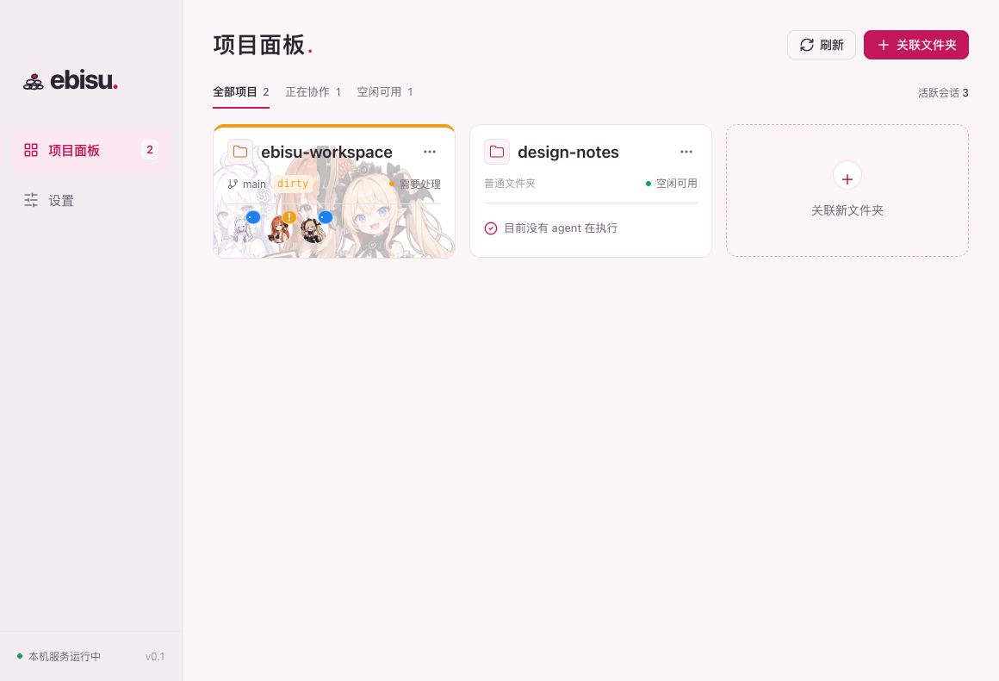
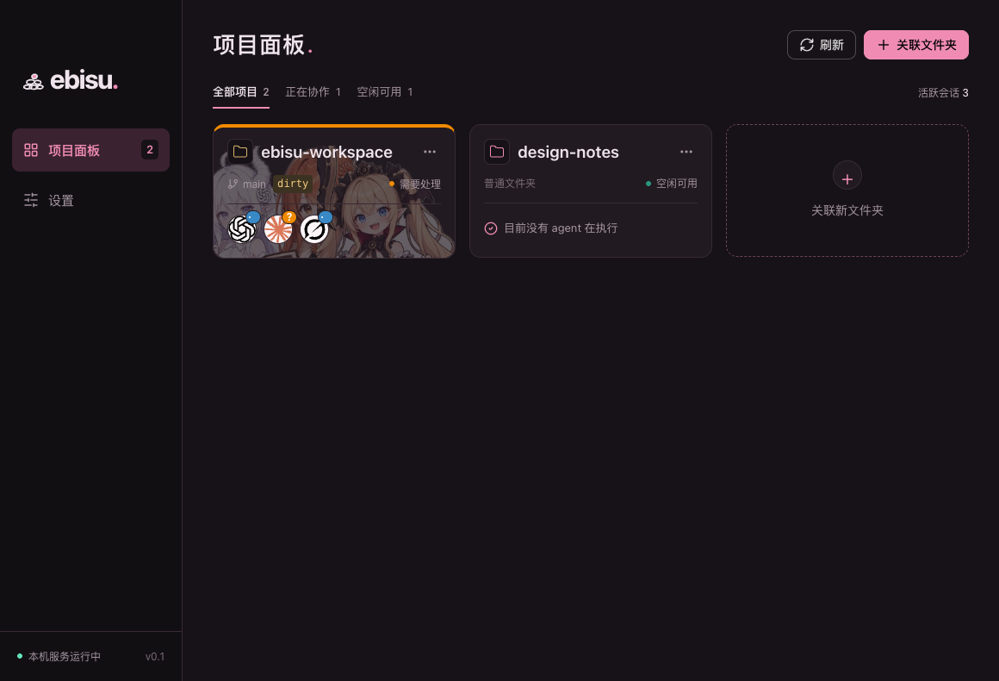

<p align="center">
  
</p>
<h1 align="center">Ebisu</h1>
<p align="center">本地与局域网项目、Agent 会话、技能管理及跨设备 Agent 对话面板</p>

把常驻的项目收进一个安静的面板：随时看到 Git 状态、哪些 agent 正在协作、哪些会话在等你处理，并集中管理跨终端使用的技能、经验与变量。可选开启局域网共享，在配对电脑间汇总状态、导入技能、复制经验，并让不同设备、不同终端的 agent 通过“聊天室”频道互相派单与回复。使用 Electron、TypeScript、Vue 3、Pinia、Naive UI 和 SQLite，首期面向 macOS Apple Silicon。

文档：[本机接口协议](docs/API.md) · [终端适配与验收边界](docs/INTEGRATIONS.md) · [技能规范](docs/SKILLS.md)

## 特性

- **项目总览**：Git 仓库与普通文件夹都能添加，不同 worktree 分别管理；长标题自动省略，悬停查看完整路径、分支与改动。
- **会话状态**：执行中、等待输入、出现故障和空闲通过卡片边框与指示灯区分；头像、任务标题和完整会话 ID 就近查看。
- **终端接入**：内置 Codex、WorkBuddy、Claude Code、Grok、Qoder、Qoder CN、DeepSeek Harness、Antigravity 八种终端的规则、skill 与原生 hook 集成，安装前自动备份，卸载只清除受管配置。上报服务离线时静默放行，绝不阻断终端 Agent 正常任务。
- **技能管理**：中央保存技能文件，按终端安装轻量入口；查看带语法高亮的源文件、复制或导出文件，管理跨终端共享经验及全局、终端、项目三层变量；支持输入技能名二次确认后整体删除技能。
- **局域网互联**：基于 mDNS 自动发现，对方确认后通过双向 TLS 配对；按设备查看项目、Git 与会话状态，浏览远端技能并按需改名导入，多选经验复制到本机或远程设备的技能。
- **聊天室（Agent 对话）**：跨设备复制的只追加消息频道。各终端安装 `ebisu-chat` 管理技能后定时轮询，把发给自己的消息派给新建或已绑定的处理会话，完成后回复写回频道；支持图片附件，频道可手动删除，闲置 8 小时自动清理。
- **桌面驻留**：托盘弹窗复用同一项目面板，关闭主窗口仅隐藏；支持跟随系统、浅色和深色主题，并根据已识别模型（含 Hunyuan）展示对应角色卡片背景。
- **本地优先**：本机服务只监听 `127.0.0.1`，请求需要 bearer token；局域网共享默认关闭，开启后使用独立的 HTTPS 服务与设备配对认证。敏感变量由系统密钥服务加密保存；不保存终端会话的提示词、回复或 Git diff，只保存 agent 主动写入聊天室的消息。

## 界面

| 浅色                                                   | 深色                                                  |
| ------------------------------------------------------ | ----------------------------------------------------- |
|  |  |

界面使用线性垒石标记，主色系取自绯红、玫粉与冰蓝的低饱和组合。

## 运行

需要 Node.js 22.12+ 和 pnpm 10。建议使用 Node.js 24 LTS。

```sh
pnpm install
pnpm dev
```

本地开发页面默认使用 `http://localhost:4175`，端口被占用时会报错。
`pnpm dev` 同时监听主进程和 preload：主进程代码变化后自动重启 Electron，preload 变化后重新加载页面，避免界面已更新而任务标题、通知服务等仍运行旧逻辑。
从未开启监听的旧开发进程切换时，需要先退出旧进程，再运行一次 `pnpm dev`。

生成的安装包位于 `dist/`。将 Ebisu 拖入“应用程序”后启动，避免安装的通知工具引用临时挂载路径。

```sh
pnpm package:mac
```

本地构建使用 ad-hoc 签名（`mac.identity: '-'`）：签名自洽，但没有 Developer ID 和公证。首次打开时 Gatekeeper 会提示“无法验证开发者”，在“系统设置 → 隐私与安全性 → 仍要打开”放行一次即可；也可以执行 `xattr -dr com.apple.quarantine /Applications/Ebisu.app`。未签名或签名损坏的包会被报“已损坏”，那种状态没有“仍要打开”按钮。

`scripts/after-pack.cjs` 在 codesign 之前修复 Electron framework 的符号链接结构：部分安装方式（例如 pnpm 把 Electron 的 framework 展开成实体文件）会让 codesign 报 `bundle format is ambiguous` 并拒绝签名，安装包随之变成“已损坏”。构建后可用 `codesign --verify --deep --strict dist/mac-arm64/Ebisu.app` 校验签名。正式分发给外部用户仍需配置 Developer ID 与公证凭据。

## 使用

1. 点击“关联文件夹”，选择 Git 仓库或普通文件夹。普通文件夹不显示 Git 区域；不同 worktree 分别添加。
2. 在“设置”检查自动探测结果，按需安装各终端的通知集成。不会自动修改所有终端配置。
3. 重启已有 agent 会话，使全局规则与 hook 生效。终端开始处理已注册目录后，其会话会出现在卡片上。
4. 执行中显示蓝色上边框和圆点；任一会话等待输入时显示黄色及“需要处理”；宿主明确报告模型接口故障（例如网络、额度或鉴权错误）时显示红色及“出现故障”。测试失败、任务阻塞或尚未合并仍按正常结束处理。恢复执行后清除等待标记；故障会保留到该项目下一次执行中上报。完成或取消后释放执行会话，十分钟无新请求也会释放执行中与等待中的会话。
5. 左侧导航包含“项目面板”“技能列表”“聊天室”和“设置”。点击托盘图标可查看同一项目面板。关闭主窗口仅隐藏窗口，彻底退出请使用托盘右键菜单或 Cmd+Q。

卡片上的 Git clean 颜色与目录忙碌灯独立：Git 干净的目录也可能正在被 agent 阅读或规划。增删改按文件统计，暂存与工作区重复改动只算一次；重命名和冲突算修改，未跟踪文件算新增。

头像详情中的“任务”显示终端提供的真实会话标题。Codex 可从本地会话索引读取与应用标题栏一致的名称，DSH 可从本地会话投影读取标题与模型，后续改名也会同步；其他终端通过通知协议上报。未取得标题时显示“未提供”，不会根据提示词生成或猜测。对于未显式接入原生 hook 的 DSH，主进程支持只读解析会话投影缓存，自动发现正在运行中的活跃会话并感知未回答的提问状态（waiting），无需完全依赖模型的主动上报。

项目标题与文件夹图标同行，长标题自动省略。悬停图标查看完整名称、路径、分支、Git 状态和增删改数量；通过三点菜单在 Finder 中打开目录。会话以单行终端商标头像显示，超出时收纳到“+x”；悬停头像或“+x”查看详情并复制完整会话 ID，Codex 会话还可通过跳转按钮在桌面客户端中打开。卡片背景使用已识别模型的角色形象（含 Hunyuan / `hy` 系列标识），模型未知时不显示背景；设置页可分别替换主窗口模型形象、托盘模型形象和终端商标，恢复默认会重置全部自定义素材。

## 局域网互联

在每台电脑安装并启动 Ebisu，添加各自的项目及终端集成，再到“设置 → 局域网共享”设置不同的本机名称并打开开关。共享默认关闭；开启后会通过 mDNS 发现同一局域网内已开启共享的设备，并在 `0.0.0.0` 的随机端口启动独立的 HTTPS 服务，不改变本机通知接口。配对后双方均可查看对方已添加的项目、Git 和会话状态、技能目录与文件，以及共同参与的聊天室频道。

1. 在“附近设备”里找到另一台电脑，点击“请求配对”。对方 Ebisu 会弹出“是否接受来自「设备名」的邀请”，点击“接受”后双方自动建立配对，设备立即从“附近设备”移到“已配对设备”；拒绝或五分钟内未处理则请求失效。
2. 项目面板与技能列表通过设备筛选切换“本机／全部设备／指定设备”，默认本机。远端项目只读，目录路径属于来源电脑，不提供 Finder 操作或本机会话跳转。
3. 点击远端技能，浏览文件和变量定义，再选择“导入本机”。导入不携带经验、变量取值、默认取值或终端安装记录，也不会自动安装或执行脚本。
4. 同名相同内容可直接使用已有技能；不同内容需要改名。导入预览会修改入口名称与明确的 `--skill` 自引用，并允许修正文本。脚本文件名、路径和其他硬编码引用需要自行检查。
5. 导入后切回“本机”，单独配置变量并安装终端入口。后续修改互不传播。解除配对会撤销访问并清除该设备缓存，保留已导入技能。
6. 在技能详情的经验页多选经验，点击“复制到技能…”，目标可以是本机技能或在线远程设备上的技能。项目级经验按项目名映射到目标设备的项目，未匹配或重名时须手动选择，不会降级为技能级经验；证据末尾追加来源行，同作用域相同内容自动跳过，整批在一个事务中写入。对端版本过旧时会提示升级。

设备每两秒拉取一次快照，十五秒未成功更新显示离线。离线仍可查看最后快照与更新时间，但不计入实时活跃统计；关闭共享立即将远端视图标为离线。共享关闭时停止发现、监听和拉取，保留配对关系。

配对请求通过 mDNS TXT 记录携带的证书指纹固定对端，后续连接采用双向 TLS 与持久证书绑定；待确认请求只保存在内存中，关闭共享或重启即失效。局域网服务只提供白名单接口：快照与技能读取、经验复制写入、聊天室消息推送／补齐与图片拉取，不提供远程技能执行或变量读取。协议另保留远程 Agent 任务接口，需要接收设备显式开启远程执行，默认关闭，当前界面不提供入口。每两台设备需分别配对；配对关系和远端缓存不会转发给第三台设备。证书私钥保存在本机数据目录 `lan-identity.json`，权限为 `0600`，请勿将该文件复制到另一台设备。

自动发现依赖同一局域网允许组播，且双方都需开启共享；本机名称可以随时修改，配对与访问不依赖地址或端口。当前自动共享地址使用 IPv4；如系统防火墙提示入站连接，请允许 Ebisu 在局域网通信。IP 或服务端口变化由自动发现恢复，无需重新配对。协议不兼容或设备证书变化时会显示错误，需要升级或解除旧配对后重新配对。

## 聊天室（Agent 对话）

聊天室是多个终端会话之间的消息通道，适合主控 agent 给其他设备或其他终端派单、收取进展与结论。每台参与设备持有频道的完整副本，agent 只调用本机 `127.0.0.1` 接口，跨设备复制由 Ebisu 经已配对的双向 TLS 完成。

1. 在“设置”绑定终端后，`ebisu-chat` 会随管理技能自动安装（已安装旧版管理技能的终端会在启动时补装）。在终端里显式调用 `ebisu-chat`，它会注册每 5 分钟一次的轮询定时任务（已存在则跳过），并告诉你本终端的参与者名称 `短主机名/终端`，例如 `almondeMac22-Mini/qoder`；默认名称取 Ebisu 设备名，不随网络 hostname 漂移。
2. 每次轮询运行 `inbox` 获取发给自己的待处理消息：worker 先认领，再把消息派给该频道已绑定的处理会话，或新建一个处理会话；一个频道只对应一个处理会话，轮询会话本身不处理任务内容。以“主控”身份调用时，在当前会话内直接处理。
3. 处理会话以认领者身份用 `progress` 汇报进展（只作心跳，不进入对方 inbox），需要对方决策或完成时用 `reply` 回复原发送者。超过 4 小时没有进展的认领视为过期，会重新分配。
4. 消息可附带最多 4 张图片（PNG／JPEG／GIF／WebP，单张不超过 4 MiB），按内容哈希存储，对端按需经 mTLS 拉取并校验，只有频道成员设备可读。
5. 在“聊天室”页面左侧选择频道，以对话流查看消息与图片缩略图；也可以删除频道，本机与其他持有副本的设备都会删除。每台设备启动后 1 分钟及之后每 8 小时自动删除闲置超过 8 小时的频道。删除标记保留 30 天，旧副本不会让已删频道复活，删除后可重建同名频道。

消息只追加不修改，按“频道 + 来源设备”连续计数，多设备并发写入没有冲突；本机写入后立即推送，每 2 秒轮询时再用版本向量补齐，离线或重启都不会丢消息，未直接配对的设备也可经中间设备获得消息。不同设备看到的跨设备先后顺序可能略有差异，需要严格顺序的事情（例如认领）不应依赖对话。

chat 客户端位于 `~/Library/Application Support/Ebisu/.ebisu/tools/chat`，常用命令有 `whoami`、`devices`、`metrics`、`inbox`、`wait`、`watch`、`claim`、`progress`、`reply`、`done`、`send`、`create`、`history`、`binding` 和 `delete`，完整说明运行 `chat protocol` 查看；其中 `wait`（阻塞到有待处理消息即返回）与 `watch`（常驻、每条新消息输出一行）是推送式叫醒信号，可替代高频轮询，由主进程变更事件即时唤醒；其中 `devices` / `metrics` 带每台设备的 CPU、内存、swap 与磁盘负载（每 30 秒采集，随设备同步，可用于派单前选择空闲设备）。通知桥 `report --chat …` 另提供 `devices`、`metrics`、`channels`、`create`、`post`、`wait`、`history`、`ack` 等底层子命令。接口细节见[本机接口协议](docs/API.md#agent-对话协议-v1)。

## 接入机制

通知集成包含全局常驻规则、通知 skill 和终端支持的原生生命周期 hook。当前 DSH 没有可安装的用户级 hook，因此安装规则与 skill，由模型主动上报并辅以主进程只读会话投影发现机制。skill 本身是模型按需调用的能力，不能提供强制执行保证，因此 hook 与规则共同补充。

| 终端             | 规则                                | Skill                                        | Hook 配置                        |
| ---------------- | ----------------------------------- | -------------------------------------------- | -------------------------------- |
| Codex            | `~/.codex/AGENTS.md` 标记块         | `~/.agents/skills/ebisu-codex/`              | `~/.codex/hooks.json`            |
| WorkBuddy        | `~/.workbuddy/AGENTS.md` 标记块     | `~/.workbuddy/skills/ebisu-workbuddy/`       | `~/.workbuddy/settings.json`     |
| Claude Code      | `~/.claude/rules/ebisu-activity.md` | `~/.claude/skills/ebisu-claude/`             | `~/.claude/settings.json`        |
| Grok             | `~/.grok/rules/ebisu-activity.md`   | `~/.grok/skills/ebisu-grok/`                 | `~/.grok/hooks/ebisu.json`       |
| Qoder            | `~/.qoder/AGENTS.md` 标记块         | `~/.qoder/skills/ebisu-qoder/`               | `~/.qoder/settings.json`         |
| Qoder CN         | `~/.qoder-cn/AGENTS.md` 标记块      | `~/.qoder-cn/skills/ebisu-qodercn/`          | `~/.qoder-cn/settings.json`      |
| DeepSeek Harness | `~/.dsh/AGENTS.md` 标记块           | `~/.dsh/skills/ebisu-dsh/`                   | 无原生 hook；主动上报 + 投影发现 |
| Antigravity      | `~/.gemini/GEMINI.md` 标记块        | `~/.gemini/config/skills/ebisu-antigravity/` | `~/.gemini/config/hooks.json`    |

安装前备份改动文件并增量合并 hook；卸载只清除 Ebisu 管理的配置。用户改写过的 skill 会被保留并报告冲突，不会直接覆盖。Codex 没有声明 hook 开关时添加带标记的开关，显式禁用时显示“能力受限”并保留用户选择。Antigravity 的 hook 采用命名配置隔离（只管理 `ebisu-antigravity` 钩子项），在 stdout 严格输出 JSON `{}` 且不介入放行拦截，保护宿主决策。DSH 不提供用户级生命周期 hook，设置页显示“能力受限”，由全局规则和 `ebisu-dsh` skill 主动上报，同时由主进程只读解析会话投影（`session_facts`）补全标题、模型并自动发现活跃会话与等待状态。

上报只是旁路观测，绝不构成任务的前置条件。当 Ebisu 未运行、服务端口不可达或运行时缺失时，主动上报脚本输出明确结论（`{"ok":false,"reason":"ebisu-not-running"}`）并以状态码 0 退出，原生 hook 保持输出为空并安全退出，保障终端任务不受任何干扰继续执行。

“检查”验证通知工具能否连接本机服务，不伪造会话。设置页按配置写入结果显示“已安装／未安装”，连通性通过“检查”单独确认。受终端版本、托管策略、沙箱和模型执行规则影响，上报可能缺失；不会用终端品牌猜测当前模型，也不会无限产生虚假心跳。

仅覆盖本机执行环境。远程 SSH、云端 agent 或容器内的 `127.0.0.1` 不等于 macOS 宿主机，没有跨主机通知代理。局域网互联只汇总各台电脑已经收到的本机通知。安装路径按表中的标准用户配置目录处理。

## 技能管理

在“技能列表”查看技能说明、依赖、经验、脚本与文件、环境变量和终端安装情况。业务文件统一保存在 `~/Library/Application Support/Ebisu/.ebisu/skills/<技能 UUID>/`，终端只安装指向中央目录的轻量入口。源文件只读，可查看语法高亮、复制路径或内容、另存为及在 Finder 中定位。

1. 在“设置”绑定终端，获得 `ebisu-skill-create`、`ebisu-skill-discuss` 和 `ebisu-chat` 三个管理技能。已有绑定会在启动时补齐管理入口，冲突时保留原配置。
2. 显式调用 `ebisu-skill-create` 创建技能包；创建完成后，在技能详情中按需安装到已绑定终端。创建不会自动安装或执行脚本。
3. 在“环境变量”填写全局、终端或项目配置，生效优先级为项目 > 终端 > 全局；清除某层取值后回退到下一层。敏感值默认遮罩，由 Electron safeStorage 加密保存。
4. 技能经验可跨项目共享，项目经验仅对所属技能和项目生效，两者均跨终端、跨模型共享。选择经验可复制 ID 列表、生成 `ebisu-skill-discuss` 讨论指令，或复制到本机及远程设备的其他技能（见[局域网互联](#局域网互联)）。
5. 不再需要的技能可在技能详情点击“删除技能”，输入技能名二次确认；agent 也可通过技能客户端执行 `delete --skill <id|name> --confirm <技能名>`。删除会移除各终端入口，并级联删除变量定义与取值（含密钥）、经验、安装记录和导入来源。中央目录先原子移入 `.ebisu/skills-trash/`，任一步失败都会回滚；删除后可用同名包重新创建。

卸载入口或解绑终端会保留中央技能与经验；手动修改过的受管入口会阻止卸载，避免覆盖用户改动。移除项目会删除该项目的经验和变量覆盖。

源码中的 `resources/skills/` 包含九个迁移技能：Debug Auto、Debug Manual、Debug Steps、Explain Code、Grill with Docs、Karpathy、Push Code、Reviewer 和 Vitest Safe。源码运行时会将缺少的技能登记到本地数据库，不自动安装到终端；当前安装包排除此目录，新安装不会附带这些默认业务技能，已有数据库中的技能继续保留。包格式、客户端命令和运行边界见[技能规范](docs/SKILLS.md)。

## 本机接口

服务仅监听 `127.0.0.1` 随机端口。运行信息保存在 `~/Library/Application Support/Ebisu/runtime.json`，权限为 `0600`。所有 HTTP 请求需要 `Authorization: Bearer <token>`；请求不允许浏览器 Origin。

```http
POST /v1/activity
Content-Type: application/json
Authorization: Bearer <runtime.json 中的 token>

{
  "path": "/Users/you/code/project",
  "terminal": "codex",
  "sessionId": "real-session-id",
  "action": "enter",
  "phase": "waiting",
  "model": "gpt-6"
}
```

`path`、`terminal`、`sessionId`、`action` 必填。`phase` 默认 `executing`，支持 `waiting` 和 `error`；`model` 未知时省略。重复 `enter` 刷新租约，`exit` 释放占用；同项目收到新的 `executing` 时会清除全部故障记录。未注册目录返回 `ignored: true`，不会自动创建卡片。

通知工具位于 `~/Library/Application Support/Ebisu/integration/report`，使用应用自带的 Electron Node 运行时：

```sh
"$HOME/Library/Application Support/Ebisu/integration/report" \
  --terminal claude --session real-session-id \
  --path /Users/you/code/project --action enter --phase waiting
```

需要取得会话 ID 时，先执行该工具的 `--new-session`：优先返回宿主提供的真实 ID，仅在缺失时生成 `local-` ID。把返回值保存在当前会话上下文中，随后始终通过 `--session` 复用。同一终端不同会话必须使用不同 ID。手动故障上报还须提供 `--model-error '宿主返回的接口错误原文'`，仅传 `--phase error` 会被忽略。服务未启动或不可达时，工具会明确返回 `{"ok":false,"reason":"ebisu-not-running"}` 并以 0 退出，绝不中断任务。

技能接口使用同一服务发现与认证机制，通过 `POST /v1/skills/<action>` 提供技能创建、删除、安装、上下文、经验和变量操作；绑定后提供的 `.ebisu/tools/skills` 客户端负责调用。聊天室接口位于 `/v1/chat/*`，其中 `wait` 为最长 900 秒的长轮询，由 `.ebisu/tools/chat` 客户端或 `report --chat` 调用；`changes` 为只返回版本号的变更信号长轮询，供 chat 客户端的 `wait`/`watch` 命令使用。高级参数、事件映射和错误码见[接口说明](docs/API.md)。

## 开发与验证

```sh
pnpm typecheck
pnpm build
pnpm test
pnpm test:smoke
```

测试直接运行即可，可在 `pnpm test` 后附测试文件只跑部分用例。

better-sqlite3 按 Electron ABI 编译，`pnpm test` 使用 Electron 的 Node 模式运行 Vitest，不需要反复切换本机 Node ABI。更换 Electron 版本后执行 `pnpm rebuild`。

端到端验收在 `pnpm build` 后运行，使用临时 HOME 和临时数据库，回放生命周期事件，校验八种终端的实际探测、原生 hook 与 camelCase 负载回放、命名 hook 隔离、技能安装与文件查看、经验与变量管理、头像、深浅主题、托盘同步与驻留行为。不会在真实终端中发起模型任务，也不改动真实终端全局配置。截图写入忽略目录 `.smoke/`。

`pnpm test` 包含局域网配对确认、证书固定、请求过期与重放、离线缓存、设备隔离、技能导入与删除、跨设备经验复制，以及聊天室的复制补齐、认领、图片附件、频道删除与自动清理；`pnpm test:smoke` 还会启动两个隔离的 Electron 实例，验收附近设备发现、配对确认弹窗、远端项目与会话、技能改名和预览编辑、导入、离线统计及解除配对。只需复测局域网界面时，可在构建后单独运行：

```sh
node scripts/lan-smoke.cjs
```

## 目录结构

```text
src/main/        SQLite、Git、路径匹配、终端集成、DSH 会话投影发现、技能管理、HTTP、局域网互联与技能导入、聊天室、远程任务、Electron 生命周期
src/preload/     受限业务 IPC 桥
src/renderer/    Vue / Pinia / Naive UI 界面
src/shared/      前后端共享协议类型
resources/       通知、技能与 chat 客户端、管理入口、迁移技能、线性图标与离线头像
scripts/         测试启动器、Electron 与双设备局域网验收、技能迁移工具
tests/           真实临时仓库与隔离集成测试
docs/            接口协议、终端适配、技能规范与界面截图
```

## 数据与隐私

数据位于 `~/Library/Application Support/Ebisu/`：`ebisu.sqlite`、`runtime.json`、`integration/`、`backups/`、自定义 `avatars/`、聊天室图片 `chat-files/` 和技能目录 `.ebisu/`。数据库保存技能元数据、经验、安装记录、变量值以及聊天室频道与消息；敏感变量加密保存，系统密钥服务不可用时拒绝操作，不回退明文。不会读取或存储终端会话的提示词、回复或 Git diff 内容；聊天室只保存 agent 主动发送的消息，频道删除或自动清理时一并删除消息与不再引用的图片。内部活动墓碑用于防止旧事件复活，目录移除会清理其会话记录。

局域网设备身份与证书私钥另存于同目录的 `lan-identity.json`；共享开关、配对关系、远端快照缓存和技能导入来源记录保存在 SQLite 中。已配对设备可见共享的项目路径、会话 ID、任务标题与技能源文件；变量定义会共享，变量取值和默认取值不会传输，经验只在你主动复制时发送到目标设备。聊天室消息与图片只复制给频道内的设备。请在共享前检查技能源文件是否包含自行硬编码的敏感内容。

## 许可

源码采用 MIT，应用图标为项目原创并随源码授权。模型形象与终端商标另见[素材署名及许可](resources/avatars/CREDITS.md)，包括 DeepSeek 形象的 CC BY-NC-SA 4.0 条件，源码许可不覆盖第三方图片。
